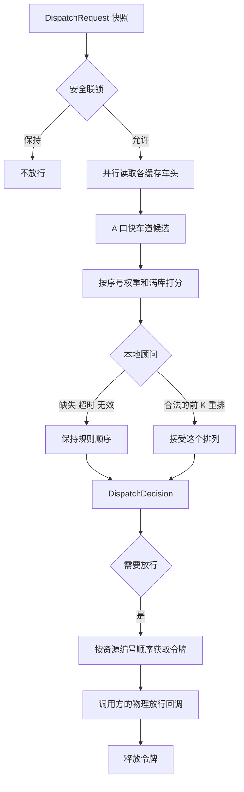

# 涂装缓存队列调度（离线、规则优先）

`PaintQueueLocalAi` 是一个 .NET 8 类库，给喷漆线出口之后的缓存道做放行决策。其他 C# 程序直接引用它即可。运行时不访问网络，也不下载模型。

喷房出口 A、B 给大约 8 条缓存道送车，后面再从缓存放行。车体有生产序号，平时优先放序号更小的车头。A 口可以走快车道直接放行。某个出口紧急要车时，立刻在当前能放的车里做决定，并降低“最小序号优先”的权重。不同缓存可以并行评估，但共用的出口和输送链必须用锁/令牌串行放行。

目标机离线：Intel i5-14500，16 GB 内存，只有 Intel UHD 770，没有独立显卡。大模型是可选的本地顾问，不是排序器。

## 为什么规则优先

放行会带动输送链和滑撬，必须能复现、能单测，并且在没有模型文件时照常工作。序号、快车道、满库和安全联锁都是明确的工艺规则，不需要模型来发明。

本地小模型只做两件事：在规则已经排好的前 K 名里重排，或者给 HMI 写一句解释。模型缺失、超时、抛错、或给出不存在的车辆编号时，引擎保持规则结果。安全联锁触发时根本不会询问模型。

## 决策顺序

优先级从高到低：

1. **安全联锁** `SafetyInterlocks`：急停、输送链未就绪、或共享资源被封锁，则整次请求不放行。
2. **紧急要车** `UrgentExitRequest`：这是模式开关，不是加分项。紧急时把最小序号权重乘以 `UrgentMinSequenceWeightFactor`（默认 0.2），并在当前快照上立即选择，不等待更好的序号。
3. **A 口快车道** `FastLaneA`：A 口快车道打开且有车时，直放候选的层级高于所有缓存车头，即使缓存里有更小的序号。B 口没有直放。
4. **最小序号** `MinSequencePreference`：只比较可放行的缓存车头。序号越小，贴近度越高。
5. **缓存均衡** `BufferLoadBalance`：越满的车道越应该先放，避免顶死。快车道不是缓存，不吃这一项。

缓存是 FIFO。只有下标 0 的车头能放行，埋在后面的更小序号不会被选中。引擎不会为了等一个埋住的序号而停线，否则前面的车不放，后面的车永远出不来。

### 打分

在同一层级内：

```
appliedWeight = 紧急 ? MinSequenceWeight × UrgentMinSequenceWeightFactor : MinSequenceWeight
closeness     = (最大车头序号 - 本车序号) / (最大车头序号 - 最小车头序号)    # 车头序号都一样时为 1
fill          = min(1, 车道车辆数 / 容量)
score         = appliedWeight × closeness + LoadBalanceWeight × fill
```

排序键：层级（快车道 1，缓存 0）降序，得分降序，序号升序，队列编号，车辆编号。顾问若返回合法重排，可以改写这个顺序，但不能发明候选，也不能推翻安全联锁。

默认旋钮见 `DispatchPolicy`：

| 旋钮 | 默认 | 作用 |
| --- | --- | --- |
| `EnableFastLaneA` | true | 关闭后，A 口在位车辆也不会直放 |
| `MinSequenceWeight` | 400 | 非紧急时序号贴近度的权重 |
| `UrgentMinSequenceWeightFactor` | 0.2 | 紧急时把序号权重乘到 80，且不允许大于 1 |
| `LoadBalanceWeight` | 150 | 满库加分的上限 |
| `AdvisorTopK` | 3 | 送给本地顾问的候选数 |
| `AdvisorTimeout` | 200 ms | 超时则回退到规则排序 |

紧急示例（默认权重）：序号 100、填充 10% 得 415；序号 110、填充 100% 得 150。非紧急放 100。紧急后序号 100 只剩 95 分，满库的 110 以 150 分胜出。

## 结构



| 项目 | 作用 |
| --- | --- |
| `src/PaintQueueLocalAi` | 类库。决策、策略、放行闸、顾问接口。不引用 Ollama 或 LLamaSharp |
| `src/PaintQueueLocalAi.Local` | 本机 Ollama 顾问。只访问回环地址 |
| `src/PaintQueueLocalAi.LlamaSharp` | 备选 GGUF 宿主。默认工作流不需要它 |
| `src/PaintQueueLocalAi.Demo` | 控制台。先跑四段规则仿真，再按配置问一次本机 Qwen |
| `tests/PaintQueueLocalAi.Tests` | 单元测试 |

物理放行不在库里。`CommitReleaseAsync` 在持有令牌时调用你的回调，回调里写 PLC。令牌在回调返回或抛错后释放。

## 四段仿真

`InMemoryPaintShopSimulator` 用默认策略和 `NullLlmAdvisor` 跑下面四段：

1. **正常放行**：8 条缓存。BUF-01 车头序号 30，后面埋着序号 1。最小车头是 BUF-02 的序号 12。B 口还有序号 4，但不能直放。
2. **A 口快车道**：缓存车头序号 5 和 8，A 口快车道上是序号 20。直放 20，尽管序号 5 的加权分更高。
3. **紧急要车**：非紧急放序号 100；紧急时权重从 400 降到 80，改放满库的序号 110。
4. **同一放行闸**：BUF-01 和 BUF-02 同时提交到 `MERGE-01`。评估可以重叠，物理回调的最大并发是 1。每条车道还会锁住自己的 `queue:{id}`，快车道则锁 `exit:A`。多把锁按资源编号排序获取，避免相反顺序死锁。

## 在其他程序里引用

```xml
<ItemGroup>
  <ProjectReference Include="path\to\src\PaintQueueLocalAi\PaintQueueLocalAi.csproj" />
</ItemGroup>
```

同一条输送链上的所有调用方要共用一个 `IReleaseGate`。引擎自己 new 出来的闸只在该实例内部有效。

```csharp
using PaintQueueLocalAi;

var gate = new ResourceTokenReleaseGate();
var engine = new DispatchEngine(
    policy: DispatchPolicy.Default,
    advisor: NullLlmAdvisor.Instance,
    releaseGate: gate);

var decision = await engine.EvaluateAsync(request);
if (decision.ShouldRelease)
{
    await engine.CommitReleaseAsync(request, async (chosen, token, ct) =>
    {
        // token 持有 MERGE 以及 queue:{车道} 或 exit:A。
        await plc.ReleaseAsync(chosen.Selected!, ct);
    });
}
```

`EvaluateAsync` 只读快照，可以并发调用。不要在评估过程中改请求里的列表。`CommitReleaseAsync` 才会拿令牌。

放行闸是进程内的。这台工控机上用一个调度进程即可。若以后要跨进程，实现同一个 `IReleaseGate`（例如命名互斥量），引擎不用改。

## 本地模型（可选）

库里没有 LLamaSharp，也没有 HTTP 客户端。四段仿真和 `InMemoryPaintShopSimulator` 仍使用 `NullLlmAdvisor`。顾问只能重排 `LlmAdviceRequest.TopCandidates` 里已有的 `CandidateId`，或补一句说明。返回 null、抛错、超时、或给出不存在的编号时，引擎保持规则顺序。安全联锁不会询问模型。不要把顾问指到公网。

### 已经装好 Ollama 和 Qwen

不需要再下载 GGUF。`--model` 必须和 `ollama list` 里显示的名字一致。演示默认是 `qwen2.5:0.5b`：更小，在这台 CPU 上更不容易顶到超时。现场如果已经拉取了 1.5b，改传 `--model qwen2.5:1.5b`。Ollama 没开、名字不对（常见是 HTTP 404，模型未找到）、或回复来不及，规则顺序照旧，四段仿真仍然可以通过。

```bash
ollama list
dotnet run --project src/PaintQueueLocalAi.Demo -- --provider ollama
dotnet run --project src/PaintQueueLocalAi.Demo -- --provider ollama --model qwen2.5:1.5b
```

演示程序先打印四段规则仿真，再对「最小序号」快照问一次本机 Qwen。`src/PaintQueueLocalAi.Demo/appsettings.json` 的默认就是 `provider=ollama`、`model=qwen2.5:0.5b`、`http://127.0.0.1:11434`。只想看四段仿真时加 `--provider null`。

0.5B 常常多写说明、换键名，或把车号 / 半截编号放进 `order`。提示词只要求一行 JSON，并给出用本次候选编号填好的示例。解析会丢掉 Markdown 和前后说明，并在能唯一对上时把车号或半截编号还原成 `CandidateId`。对不上的编号仍然无效，放行保持规则顺序。无效重排或解析失败时，Demo 会打印截断的模型原文。

放行节拍里的 `DispatchPolicy.AdvisorTimeout` 仍是 200 ms。演示里的那一次调用默认放到 8 秒，方便在这台 CPU 上看到回复；产线不要把 8 秒挡在 `CommitReleaseAsync` 前面。

在宿主里接上同一实现：

```csharp
using PaintQueueLocalAi;
using PaintQueueLocalAi.Local;

var advisor = new OllamaLoopbackAdvisor(new OllamaAdvisorOptions
{
    BaseUrl = "http://127.0.0.1:11434",
    Model = "qwen2.5:0.5b" // 必须与 ollama list 一致；已有 1.5b 时改为 qwen2.5:1.5b
});
var engine = new DispatchEngine(advisor: advisor);
```

`OllamaLoopbackAdvisor` 只接受 `127.0.0.1`、`localhost`、`::1`，并关闭代理和自动重定向。连接被拒绝时抛错，引擎记为失败并保持规则顺序。

### 模型体量

| 模型 | 体量 | 用途 |
| --- | --- | --- |
| Qwen2.5-0.5B | 约 400 MB | 演示默认。更小，CPU 上更容易落在超时内。Ollama 标签一般是 `qwen2.5:0.5b` |
| Qwen2.5-1.5B-Instruct Q4_K_M | 约 1 GB | 现场已安装时的推荐体量。标签一般是 `qwen2.5:1.5b`，需显式 `--model` |
| Qwen2.5-3B-Instruct Q4_K_M | 约 2 GB | 解释更好，但不适合卡在 200 ms 的放行节拍里 |
| Phi-3-mini-4k-instruct Q4 | 约 2.2 GB | 和 3B 类似的备选 |

i5-14500 有 6 个性能核和 8 个能效核，20 线程，内存 16 GB。UHD 770 没有可用的 CUDA 路径，不要按独显来估算。Ollama 在这台机器上走 CPU。llama.cpp 的 CPU 后端是备选；Vulkan 只能当作试验。7B 及以上的 Q4 权重要占数 GB，再叠 MES/SCADA 容易把工控机顶满，不建议放进放行回路。

默认 200 ms 在 CPU 上更适合 0.5B 生成很短的编号列表，因此演示默认 `qwen2.5:0.5b`。现场已经装了 1.5B 时，它仍是推荐体量，用 `--model qwen2.5:1.5b`，同样只够很短的回复。3B 更适合在规则已经放行之后，异步给 HMI 补一句解释，不要挡在 `CommitReleaseAsync` 里面。本仓库不附带权重，也不会在运行时下载。模型文件由现场自行拷贝，或直接使用已经装好的 Ollama 模型。

### 还没有模型时再安装

脚本默认什么都不下载。已经有 Ollama 和 Qwen 就不要加 `-DownloadModel` / `--download-model`。

Windows：

```powershell
powershell -ExecutionPolicy Bypass -File scripts\install-windows.ps1
powershell -ExecutionPolicy Bypass -File scripts\install-windows.ps1 -InstallOllama
powershell -ExecutionPolicy Bypass -File scripts\install-windows.ps1 -DownloadModel -Variant 1.5b
```

Linux 编程机：

```bash
bash scripts/install-linux.sh
bash scripts/install-linux.sh --install-ollama
bash scripts/install-linux.sh --download-model --variant 1.5b
```

请把 `OLLAMA_HOST` 留在 `127.0.0.1:11434`。离线 GGUF 可以注册成 Ollama 模型，而不是交给 LLamaSharp：

```bash
ollama create paint-queue-advisor -f scripts/ollama/Modelfile
dotnet run --project src/PaintQueueLocalAi.Demo -- --provider ollama --model paint-queue-advisor
```

权重放在 `models/`（已忽略），不要提交进 git。

### 微调

主路径是 LoRA，不是 QLoRA。训完合并，导出 GGUF，再用 Modelfile 执行 `ollama create`，产线仍通过 Ollama 调用。步骤在 [finetune/README.md](finetune/README.md)。QLoRA 只在有 NVIDIA GPU 时可选。LLamaSharp 不是这条工作流的一环。

```bash
dotnet run --project src/PaintQueueLocalAi.Demo -- --export-dataset finetune/data/paint_queue_advisor.jsonl --provider null
python3 finetune/train_lora.py --dry-run --data finetune/data/paint_queue_advisor.jsonl
```

### 备选：直接加载 GGUF

没有 Ollama 时，宿主可以引用 `src/PaintQueueLocalAi.LlamaSharp`。它使用 CPU 后端，并把 `GpuLayerCount` 固定为 0。文件缺失或尚未预热时返回 null。演示程序不依赖这个项目。

## 构建与运行

需要 .NET 8 SDK。还原测试包时构建机要能访问 NuGet；产线运行时不需要网络。

```bash
dotnet build
dotnet test
dotnet run --project src/PaintQueueLocalAi.Demo
```

演示程序打印中文仿真记录。四段都通过时退出码为 0，即使后面的 Ollama 调用回退到规则。`--provider null` 会跳过这次顾问调用。

## English summary

`PaintQueueLocalAi` is an offline .NET 8 library that decides which painted body to release from a bank of about eight buffer lanes. A deterministic `DispatchEngine` is the source of truth. Priority is: safety interlocks, urgent exit demand (which lowers the min-sequence weight), booth A fast-lane direct release, smallest production sequence among lane heads, then fuller-buffer preference. Only the head of a FIFO lane can move.

`ILlmAdvisor` may reorder the top few candidates or add an explanation. `NullLlmAdvisor` still drives the four scripted scenarios. The local path is loopback Ollama with Qwen. The demo default is `qwen2.5:0.5b` (smaller, and a better fit for the CPU timeout on this machine). The name must match `ollama list`. Plants that already have the 1.5B tag should pass `--model qwen2.5:1.5b`; that size stays the recommended plant model when it is installed. If Ollama is down, the model name is missing (HTTP 404), the reply is slow, or the output is wrong, the rule order stands. The engine never calls a cloud API. On an i5-14500 with 16 GB of RAM and UHD 770, keep the release-path timeout at 200 ms. Fine-tune with LoRA, then `ollama create` from the Modelfile. GGUF via LLamaSharp is optional and is not required for that workflow. Do not put a 7B model on the release path.

Queue snapshots are scored in parallel. `CommitReleaseAsync` holds an `IReleaseGate` token for the shared conveyor plus the lane or exit A, so two lanes cannot move the same hardware at once. Share one gate across every caller of that conveyor.
